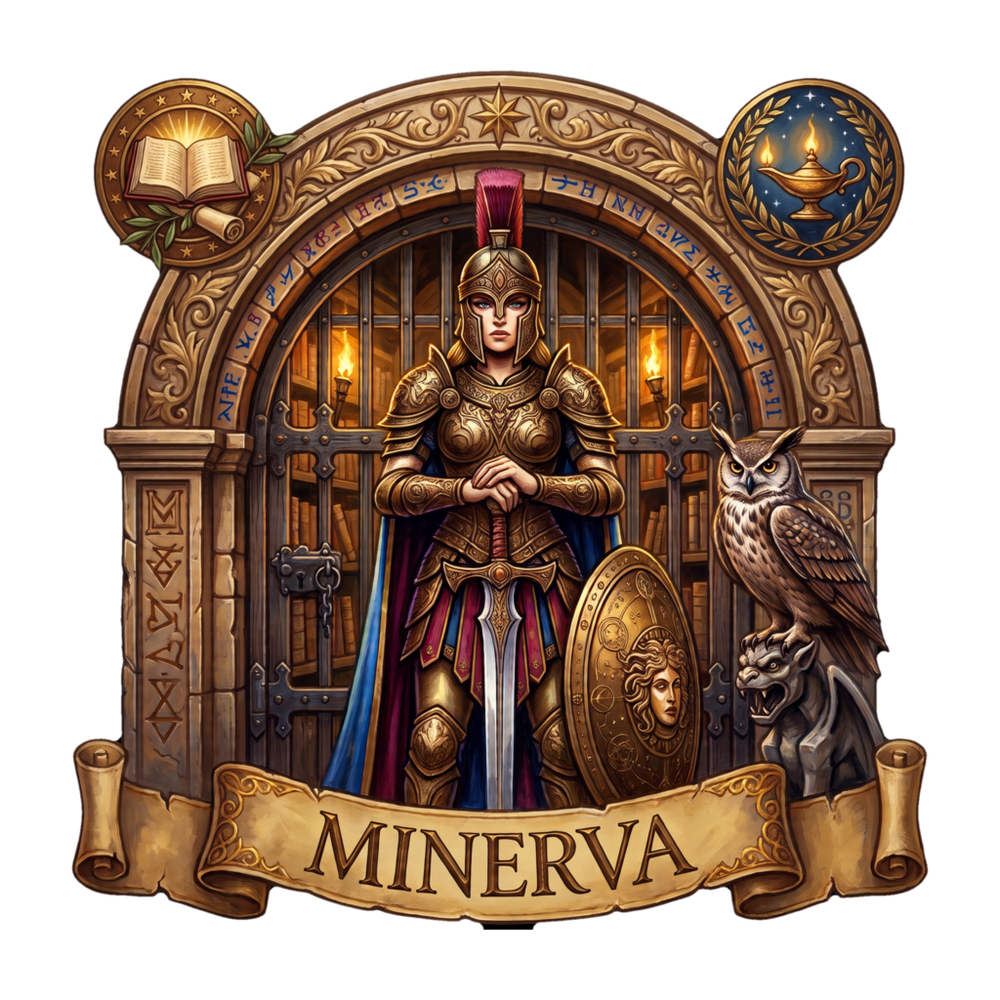
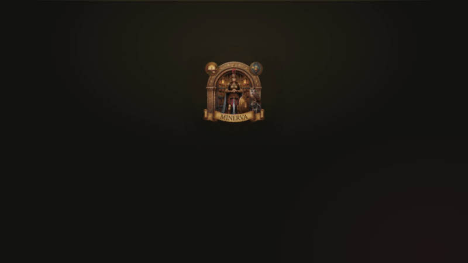

<div align="center">

<p align="center">
  <a href="./README.md"><strong>🇬🇧 English</strong></a>
  &nbsp;&nbsp;·&nbsp;&nbsp;
  <a href="./README_ES.md"><strong>🇪🇸 Español</strong></a>
</p>

<br>



# Minerva

<p><strong>The next-generation digital book reader.</strong><br>
<em>Focused on the reader and on privacy.</em></p>

<br>

[](https://github.com/abismalmx/Minerva/actions/workflows/pull-request.yml)
[](https://github.com/abismalmx/Minerva/actions/workflows/secret-scan.yml)
[](LICENSE)
[](https://workers.cloudflare.com)
[](https://koreader.rocks/)
[](https://nextjs.org)
[](https://v2.tauri.app)
[](https://pnpm.io)
[](#privacy-absolutely-zero-telemetry)

</div>

<br>

<p align="center">
  
</p>

<br>

## 📖 Official guides

<p align="center">
  <a href="./docs/USER_GUIDE_EN.md"><strong>📘 User Guide (EN)</strong></a>
  &nbsp;&nbsp;·&nbsp;&nbsp;
  <a href="./docs/USER_GUIDE_ES.md"><strong>📗 Guía de Usuario (ES)</strong></a>
  &nbsp;&nbsp;·&nbsp;&nbsp;
  <a href="./docs/DEVELOPER_GUIDE_EN.md"><strong>🛠️ Developer Guide (EN)</strong></a>
  &nbsp;&nbsp;·&nbsp;&nbsp;
  <a href="./docs/DEVELOPER_GUIDE_ES.md"><strong>🛠️ Guía de Desarrollador (ES)</strong></a>
</p>

| Guide | What you will find |
| --- | --- |
| **[User Guide (EN)](./docs/USER_GUIDE_EN.md)** | Every feature explained end to end: the library, the reader, the notebook, sync, TTS, dictionaries, OPDS. |
| **[Guía de Usuario (ES)](./docs/USER_GUIDE_ES.md)** | La misma guía, en español. |
| **[Developer Guide (EN)](./docs/DEVELOPER_GUIDE_EN.md)** | Architecture, environment setup, the zero-telemetry protocol, build and packaging, contribution workflow. |
| **[Guía de Desarrollador (ES)](./docs/DEVELOPER_GUIDE_ES.md)** | La misma guía técnica, en español. |

---

## What is Minerva

Minerva is a **multiplatform e-book reader** — desktop (Windows, macOS, Linux), mobile (Android, iOS) and web — built on **Next.js 16** and **Tauri 2**.

It is born from [Readest](https://github.com/readest/readest) and keeps its reading engine. **What changes is the direction:** the reader comes first, your data stays on your machine, and the server — *if you want one* — is yours.

This repository publishes the whole thing so you can **self-host its synchronization**. The app and the backend deploy separately, and neither is mandatory.

```text
┌───────────────┐        ┌──────────────────────────────┐
│  Minerva      │  HTTPS │  Cloudflare Worker            │
│  (desktop,    │ ─────► │  minerva-sync                 │
│   mobile, web)│        │  ├─ D1  (SQLite)  accounts,   │
│               │        │  │    books, notes, replicas   │
│  KOReader     │ ─────► │  └─ R2  books, covers          │
└───────────────┘        └──────────────────────────────┘
```

The app reads and writes against **your** server: no intermediary account, no third-party traffic, and nothing to pay for.

| | |
| --- | --- |
| **Formats** | EPUB, PDF, MOBI, KF8 (AZW3), FB2, CBZ/CBR, TXT, HTML, MD — 12+ in total |
| **Platforms** | macOS, Windows, Linux, Android, iOS, Web (PWA) |
| **Sync** | Cloudflare Workers + D1 + R2, fully self-hostable, KOSync-compatible |
| **Local database** | SQLite (Turso) with full-text search |
| **License** | AGPL-3.0 |

---

## Privacy, absolutely: zero telemetry

This is the fork's central promise, and it is enforced at the code level rather than promised in a policy.

**The eradication commit touched 98 files and deleted 2,689 lines. Zero third-party SDKs remain.**

| Removed from the codebase | What it was |
| --- | --- |
| **PostHog** | Product analytics, user profiling and automatic event capture. |
| **Sentry** | Error and crash reporting. Minerva has no crash reporting. |
| **Usage data collection** | No events, no profiles, no recorded sessions, no background queues. |
| **Background calls** | The app does not talk to any third party behind your back. |
| **Embedded credentials** | Supabase, Stripe and PostHog keys in base64 are gone from the repository. |
| **Account scripts** | `inspect-accounts.mjs` and `merge-accounts.mjs` were removed from the project. |

Verify it yourself — these must print nothing:

```bash
# No analytics dependency anywhere in the workspace
grep -rn "posthog\|@sentry\|mixpanel\|amplitude-js\|google-analytics\|gtag" \
  --include=package.json apps/ packages/ | grep -v node_modules

# No telemetry crate in the Rust tree
grep -n "posthog\|sentry\|analytics\|telemetry" apps/minerva-app/src-tauri/Cargo.toml

# No analytics host in application code
grep -rniE "posthog|sentry\.io|api\.mixpanel|api\.amplitude" \
  apps/minerva-app/src --include=*.ts --include=*.tsx
```

### Zero-knowledge encryption

Sensitive synced fields — catalog passwords, credentials, replica blobs — are **encrypted in your client before they are uploaded**. The server only ever stores ciphertext and a salt.

```text
Envelope: { c: ciphertext, i: iv, s: saltId, alg: "aes-gcm/pbkdf2-600k-sha256", h: sha256 sidecar }
Key:      PBKDF2-HMAC-SHA256 · 600,000 iterations · AES-GCM-256 · 12-byte random IV
```

Your **account passphrase** is never stored either. The Worker keeps only a stretched derivation (PBKDF2 with a per-account salt, or Argon2id), so **a database dump cannot recover it** — not even a weak one.

### Sovereignty over your data

- Your books live on **your disk**, in **your bucket**, or in **your** WebDAV / Google Drive / S3 / OneDrive / iCloud.
- **No account is required.** The whole app works signed out.
- **No purchase, no payment cloud.** A self-hosted deployment has no store, so every feature is unlocked.
- The app also speaks the **KOSync** protocol, so **KOReader** can use the same server for its own progress sync.

---

## Minerva vs. Readest

| | **Readest** | **Minerva** |
| --- | --- | --- |
| **Account** | Required to use the hosted service | Optional. The whole app works without registering |
| **Backend** | The project's hosted service | **Yours**: Cloudflare Workers + D1 + R2 |
| **Telemetry** | Collected by default | **Eradicated**: the code does not exist |
| **Sensitive data** | — | Encrypted in the client with your passphrase |
| **Identity** | The Readest brand | Minerva: bronze and gold over warm neutrals |

**Zero-knowledge encryption:** the server only stores encrypted data, and can never learn your passwords or your notes.

---

## Key features

### 📓 The Notebook: Markdown notes linked to every book

A real rich-text editor whose **durable format is Markdown**, one document per book, organised by chapter.

- **Real Markdown** — rich editing with a round-trip guaranteed by tests.
- **Organised by chapters** — *All chapters* · *General notes* · every entry in the table of contents.
- **Citations that go back** — a CFI link takes you to the exact point in the text, with chapter and page.
- **Travels with the book** — it is stored in the book's `config.json`, not in a database.

The notebook syncs through the same encrypted replica protocol as everything else, and the whole document survives a crash: a local recovery copy is kept and reconciled on the next save.

> **Note.** The notebook has no dedicated export. Annotations and excerpts export to Markdown via *Export Markdown*; the notebook itself is copied out of the editor.

### 🔎 Images of people, places and concepts — without leaving the reading view

Select a name in the text, hit **Photo**, and Minerva looks it up on **Wikipedia** and **Wikimedia Commons**, right next to the passage you are reading.

1. **Select** — the name of a person, a place or a term inside the text.
2. **Tap Photo** — the lookup button appears on the floating toolbar.
3. **Pick and paste** — the image and, optionally, a biographical summary land in your note as Markdown.

**Only the search string leaves your device.** Never the book content, never the title, never the extract.

### 📖 Continue reading: a poster, not a list

The library opens with the book you were reading, its **spine** filled to the exact progress, the estimated time left, and a single **Continue** button — instead of another row in a grid.

The reading pace behind the estimate comes from your own local statistics (SQLite), never from a server.

---

## Downloads

**Latest release:** <https://github.com/abismalmx/Minerva/releases/latest>

### Binaries

| Platform | Asset | Architecture | Notes |
| --- | --- | --- | --- |
| **Linux** | `Minerva_1.0.5_amd64.AppImage` | x86_64 | Self-contained, runs on any distro. Built on the **CEF** runtime. |
| **Linux** | `Minerva_1.0.5_aarch64.AppImage` | aarch64 | For ARM devices (Raspberry Pi, ARM laptops). |
| **Windows** | `Minerva_1.0.5_x64-portable.exe` | x86_64 | **PE32+ portable**, no installer, no admin rights needed. |
| **Windows** | `Minerva_1.0.5_x64-setup.exe` | x86_64 | NSIS installer, embeds the WebView2 bootstrapper and the Explorer thumbnail handler. |
| **Windows** | `Minerva_1.0.5_arm64-portable.exe` | aarch64 | ARM64 portable build. |
| **Android** | `Minerva_1.0.5_arm64.apk` | arm64-v8a | Signed release APK. |
| **Android** | `Minerva_1.0.5_armv7.apk` | armeabi-v7a | Signed release APK. |
| **Android** | `Minerva_1.0.5_legacy.apk` | x86 / x86_64 | Signed release APK for emulators and legacy devices. |
| **macOS** | `Minerva_1.0.5_universal.dmg` | x86_64 + arm64 | Universal binary (Apple Silicon and Intel). |

Direct links to the latest build:

```bash
# Linux (x86_64)
wget https://github.com/abismalmx/Minerva/releases/latest/download/Minerva_1.0.5_amd64.AppImage
chmod +x Minerva_1.0.5_amd64.AppImage && ./Minerva_1.0.5_amd64.AppImage

# Windows (portable, x64)
curl -L -o Minerva.exe https://github.com/abismalmx/Minerva/releases/latest/download/Minerva_1.0.5_x64-portable.exe

# Android (arm64)
curl -L -o Minerva.apk https://github.com/abismalmx/Minerva/releases/latest/download/Minerva_1.0.5_arm64.apk
```

Every release also ships `.sig` files (minisign) and a `latest.json` manifest that drives the in-app auto-updater.

### Self-hosted backend — one command

The whole sync backend fits in Cloudflare's free tier, and no credit card is required.

```bash
git clone --recurse-submodules https://github.com/abismalmx/Minerva.git
cd minerva

# Cloudflare session (opens the browser the first time)
npx wrangler login

# Creates D1, creates R2, generates the secret, applies the migrations and
# publishes the Worker. It is idempotent: safe to re-run.
./deploy-cloudflare.sh
```

The script prints the Worker's URL when it finishes and leaves the app configured in `apps/minerva-app/.env.local`.

<details>
<summary>What it does, step by step</summary>

| Step | What happens |
| --- | --- |
| 1 | Verifies the tools and the Cloudflare session (`wrangler whoami` / `wrangler login`). |
| 2 | Creates (or reuses) the **D1** database `minerva-sync` and extracts its `database_id`. |
| 3 | Creates (or reuses) the **R2** bucket `minerva-library`. |
| 4 | Writes `database_id` and `bucket_name` into `wrangler.toml` without touching the rest of your configuration. |
| 5 | Generates a 32-byte `JWT_SECRET` and registers it in **Cloudflare Secrets** (never in `wrangler.toml`). |
| 6 | Applies the remote migrations (`0001` to `0004`). |
| 7 | Publishes the `minerva-cloudflare` Worker to `*.workers.dev`. |
| 8 | Checks `/health` and writes `NEXT_PUBLIC_API_BASE_URL` into `apps/minerva-app/.env.local`. |

To rotate the secret without invalidating sessions: `./deploy-cloudflare.sh --rotate-secret`.

</details>

### Connect the app to your server

1. Open Minerva: **Settings → Sync → Minerva Cloud (Cloudflare)**.
2. Paste the Worker's URL and press **Test connection**.
3. Register an account with an email and a *passphrase*. The server only keeps a PBKDF2 derivation: **it cannot recover your passphrase**, so keep it safe.
4. On another device, sign in with the same email and passphrase: the library, the progress, the notes and the bookmarks sync.

For KOReader: **Settings → Sync → KOReader**, with the Worker's URL, your email and your passphrase.

---

## Development

### Requirements

| Tool | Version | For |
| --- | --- | --- |
| [Node.js](https://nodejs.org) | 24 | UI and Next.js build |
| [pnpm](https://pnpm.io/installation) | 11.1.1 | Monorepo package manager |
| [Rust](https://www.rust-lang.org/tools/install) | 1.90 or newer | Tauri native backend |
| [Tauri prerequisites](https://v2.tauri.app/start/prerequisites/) | per OS | System libraries |

For the **Worker** alone, all you need is Node.js and a Cloudflare account.

### Clone and prepare

The pnpm workspace uses **Git submodules** for the dependencies with their own upstream (the reading engine, the Tauri fork, the dictionaries):

```bash
git clone --recurse-submodules https://github.com/abismalmx/Minerva.git
cd minerva

# If you had already cloned it without the submodules:
git submodule update --init --recursive

pnpm install --frozen-lockfile

# Copy the vendored dist libs into the public directory
pnpm --filter @minerva/app setup-vendors
```

### Run and build

```bash
pnpm dev-web              # web UI (no Rust compilation: the fast loop)
pnpm tauri dev            # desktop app (compiles the Rust backend)
pnpm --filter @minerva/app build-web   # web build
pnpm tauri build          # desktop binaries in target/release/bundle/
```

### Common commands

All of them run from the monorepo root.

| Command | What it does |
| --- | --- |
| `pnpm dev-web` | Web development server |
| `pnpm tauri dev` | Desktop app with hot reload |
| `pnpm lint` | `tsc --noEmit` + Biome over the web code |
| `pnpm format` / `pnpm format:check` | Format with Biome / check the formatting |
| `pnpm test` | Unit suite (Vitest + jsdom), in watch mode |
| `pnpm test --run` | The same suite, a single run |
| `pnpm --filter @minerva/app test:browser` | Browser tests (Chromium) |
| `pnpm --filter @minerva/app test:tauri` | Tauri integration tests |
| `pnpm --filter @minerva/app test:lua` | KOReader plugin tests |
| `pnpm fmt:check` / `pnpm clippy:check` | `cargo fmt` / `cargo clippy` on the Rust backend |
| `pnpm check:eink-identity` | Checks the parity of the e-ink identity list |
| `pnpm deploy:cloudflare` | Deploys the Worker |

The Worker's tests — which run the **real migrations against a real SQLite database** — live in the app's suite:

```bash
cd apps/minerva-app
pnpm test --run src/__tests__/workers/
```

> **On Linux, `pnpm tauri` runs on the CEF runtime** (Chromium Embedded Framework) instead of WebKitGTK, and needs **Rust ≥ 1.95**. The build wrapper swaps `Cargo.lock` for `Cargo.cef.lock` and back. See the [Developer Guide](./docs/DEVELOPER_GUIDE_EN.md) for the details.

---

## Project structure

```text
minerva/
├── apps/
│   ├── minerva-app/                 # The app (Next.js 16 + Tauri 2)
│   │   ├── src/                     # UI, services and state
│   │   ├── src-tauri/               # Native backend in Rust
│   │   ├── workers/
│   │   │   ├── minerva-sync/        # <-- The self-hostable backend
│   │   │   ├── iap-reconcile/       # In-app purchase reconciliation
│   │   │   └── send-email/          # Extension email intake
│   │   ├── extensions/              # "Send to Minerva" browser extension
│   │   └── docs/                    # Application technical documentation
│   ├── minerva-calibre-plugin/      # Calibre plugin
│   ├── minerva-crosspoint-plugin/   # CrossPoint plugin
│   └── minerva.koplugin/            # KOReader plugin (Lua)
├── packages/                        # Dependencies with their own upstream (submodules)
├── data/                            # Icons, screenshots and release metadata
├── docs/                            # Guides and runbooks
├── fastlane/                        # Store publishing automation
├── nix/                             # Nix packaging
├── scripts/                         # Development and deployment utilities
└── .github/                         # CI, templates and policies
```

---

## Contributing

Pull requests are welcome. Before sending one:

1. Read [`CONTRIBUTING.md`](./CONTRIBUTING.md) and [`CODE_OF_CONDUCT.md`](./CODE_OF_CONDUCT.md).
2. Open an issue if the change is an opinion about the product.
3. Validate before pushing: `pnpm lint`, `pnpm test --run` and, if you touch Rust, `pnpm fmt:check` and `pnpm clippy:check`.

The architecture guide lives in [`apps/minerva-app/docs/architecture.md`](./apps/minerva-app/docs/architecture.md), and the full technical reference in the [Developer Guide](./docs/DEVELOPER_GUIDE_EN.md).

If you find a vulnerability, **do not open a public issue**: follow the policy in [`SECURITY.md`](./SECURITY.md).

---

## License

Minerva is free software under the **GNU Affero General Public License v3.0** or later. The full text is in [`LICENSE`](./LICENSE).

Because of section 13 of the AGPL, anyone who uses a modified Minerva over a network must be offered the corresponding source code. Minerva is an independent project; its origin, the prior work it derives from, the authorship notices and the attribution to the people and projects that made it possible are recorded in [`NOTICE`](./NOTICE).

## Credits

- **Anthony Rios Licea** — Software Engineer · author of the Minerva fork and its privacy work.
- **Bilingify LLC** and the **Readest** contributors — the original authors of Readest, whose reading engine Minerva builds on. Copyright © Bilingify LLC and the Readest contributors.
- **Readest** — <https://github.com/readest/readest> — the upstream project.

The original copyright and license notices are preserved, as the license requires. The modifications Minerva introduces — the name, the visual identity, the user-facing text — carry their dates and authors in the version control history.

### Acknowledgments

Third-party components keep their own licenses:

- [foliate-js](https://github.com/johnfactotum/foliate-js) — MIT.
- [zip.js](https://github.com/gildas-lormeau/zip.js) — BSD-3-Clause.
- [fflate](https://github.com/101arrowz/fflate) — MIT.
- [PDF.js](https://github.com/mozilla/pdf.js) — Apache-2.0.
- [daisyUI](https://github.com/saadeghi/daisyui) — MIT.
- [marked](https://github.com/markedjs/marked) — MIT.
- [Next.js](https://github.com/vercel/next.js) — MIT.
- [React](https://github.com/facebook/react) — MIT.
- [react-icons](https://github.com/react-icons/react-icons) — various open-source licenses.
- [Tauri](https://github.com/tauri-apps/tauri) — MIT / Apache-2.0.

Typefaces included or served from the web: [Bitter](https://fonts.google.com/specimen/Bitter), [Fira Code](https://fonts.google.com/specimen/Fira+Code), [Inter](https://fonts.google.com/specimen/Inter), [Literata](https://fonts.google.com/specimen/Literata), [Merriweather](https://fonts.google.com/specimen/Merriweather), [Noto Sans](https://fonts.google.com/specimen/Noto+Sans), [Roboto](https://fonts.google.com/specimen/Roboto), [LXGW WenKai](https://github.com/lxgw/LXGW-WenKai), [MiSans](https://hyperos.mi.com/font/en/), [Source Han](https://github.com/adobe-fonts/source-han-sans/) and [WenQuanYi Micro Hei](http://wenq.org/wqy2/).

---

<div align="center">

**Minerva** — your reading · your notes · your privacy.

*Derived from Readest · Copyright © Bilingify LLC and the Readest contributors · AGPL v3*

</div>
