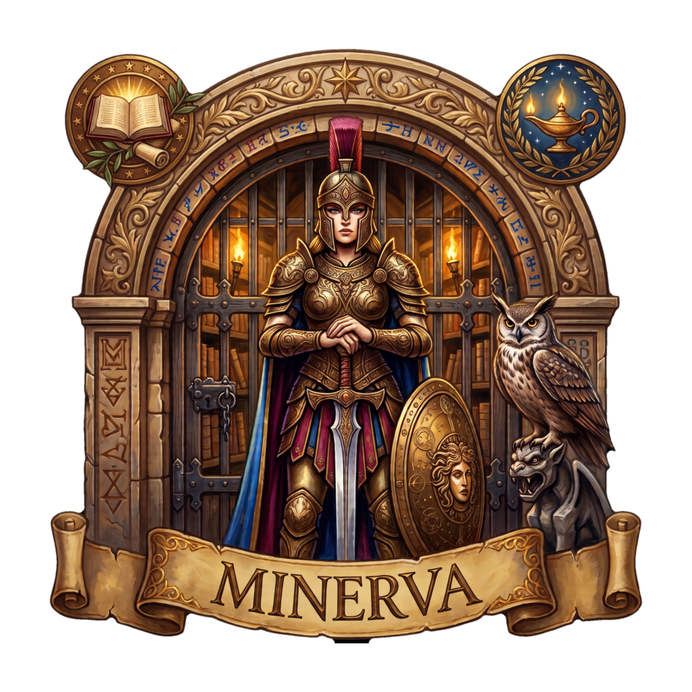
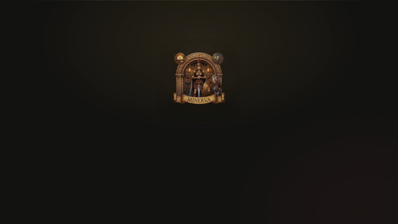

<div align="center">

<p align="center">
  <a href="./README.md"><strong>🇬🇧 English</strong></a>
  &nbsp;&nbsp;·&nbsp;&nbsp;
  <a href="./README_ES.md"><strong>🇪🇸 Español</strong></a>
</p>

<br>



# Minerva

<p><strong>El lector de libros digitales de última generación.</strong><br>
<em>Enfocado en el lector y en la privacidad.</em></p>

<br>

[](LICENSE)
[](#privacidad-absoluta-cero-telemetría)
[](https://v2.tauri.app)
[](https://workers.cloudflare.com)

</div>

<br>

<p align="center">
  
</p>

<br>

## 📖 Guías oficiales

<p align="center">
  <a href="./docs/USER_GUIDE_ES.md"><strong>📗 Guía de Usuario (ES)</strong></a>
  &nbsp;&nbsp;·&nbsp;&nbsp;
  <a href="./docs/USER_GUIDE_EN.md"><strong>📘 User Guide (EN)</strong></a>
  &nbsp;&nbsp;·&nbsp;&nbsp;
  <a href="./docs/DEVELOPER_GUIDE_ES.md"><strong>🛠️ Guía de Desarrollador (ES)</strong></a>
  &nbsp;&nbsp;·&nbsp;&nbsp;
  <a href="./docs/DEVELOPER_GUIDE_EN.md"><strong>🛠️ Developer Guide (EN)</strong></a>
</p>

| Guía | Qué encontrarás |
| --- | --- |
| **[Guía de Usuario (ES)](./docs/USER_GUIDE_ES.md)** | Todas las funcionalidades explicadas de principio a fin: la biblioteca, el lector, el cuaderno, la sincronización, el TTS, los diccionarios, OPDS. |
| **[User Guide (EN)](./docs/USER_GUIDE_EN.md)** | The same guide, in English. |
| **[Guía de Desarrollador (ES)](./docs/DEVELOPER_GUIDE_ES.md)** | Arquitectura, entorno, protocolo de cero telemetría, compilación y empaquetado, flujo de contribución. |
| **[Developer Guide (EN)](./docs/DEVELOPER_GUIDE_EN.md)** | The same technical guide, in English. |

---

## Qué es Minerva

Minerva es un **lector de libros electrónicos multiplataforma** — escritorio (Windows, macOS, Linux), móvil (Android, iOS) y web — construido sobre **Next.js 16** y **Tauri 2**.

Nace de [Readest](https://github.com/readest/readest) y conserva su motor de lectura. **Lo que cambia es la dirección:** el lector manda, tus datos se quedan en tu máquina y el servidor —*si lo quieres*— es el tuyo.

Este repositorio publica todo para que puedas **autoalojar su sincronización**. La app y el backend se despliegan por separado, y ninguno es obligatorio.

```text
┌───────────────┐        ┌──────────────────────────────┐
│  Minerva      │  HTTPS │  Cloudflare Worker            │
│  (escritorio, │ ─────► │  minerva-sync                 │
│   móvil, web) │        │  ├─ D1  (SQLite)  cuentas,    │
│               │        │  │    libros, notas, réplicas │
│  KOReader     │ ─────► │  └─ R2  libros, portadas       │
└───────────────┘        └──────────────────────────────┘
```

La app lee y escribe contra **tu** servidor: no hay cuenta de por medio, no hay tráfico hacia terceros y no hay que pagar.

| | |
| --- | --- |
| **Formatos** | EPUB, PDF, MOBI, KF8 (AZW3), FB2, CBZ/CBR, TXT, HTML, MD — 12+ en total |
| **Plataformas** | macOS, Windows, Linux, Android, iOS, Web (PWA) |
| **Sincronización** | Cloudflare Workers + D1 + R2, autoalojable |
| **Base de datos local** | SQLite (Turso) con búsqueda full-text |
| **Licencia** | AGPL-3.0 |

---

## Privacidad absoluta: cero telemetría

Esta es la promesa central del fork, y se cumple en el código, no en una política.

**El commit de erradicación tocó 98 archivos y eliminó 2.689 líneas. No queda ni un SDK de terceros.**

| Eliminado del código | Qué era |
| --- | --- |
| **PostHog** | Analítica de producto, perfiles de usuario y captura automática de eventos. |
| **Sentry** | Reporte de errores y de fallos en producción. En Minerva no hay crash reporting. |
| **Recopilación de datos de uso** | Sin eventos, sin perfiles, sin sesiones grabadas, sin colas en segundo plano. |
| **Llamadas en segundo plano** | La app no habla con ningún tercero por la espalda. Punto. |
| **Credenciales embebidas** | Supabase, Stripe y PostHog en base64 salieron del repositorio. |
| **Scripts de cuentas** | `inspect-accounts.mjs` y `merge-accounts.mjs` se eliminaron del proyecto. |

Compruébalo tú mismo — estos comandos no deben imprimir nada:

```bash
# Ninguna dependencia de analítica en el workspace
grep -rn "posthog\|@sentry\|mixpanel\|amplitude-js\|google-analytics\|gtag" \
  --include=package.json apps/ packages/ | grep -v node_modules

# Ningún crate de telemetría en el árbol de Rust
grep -n "posthog\|sentry\|analytics\|telemetry" apps/minerva-app/src-tauri/Cargo.toml

# Ningún host de analítica en el código de aplicación
grep -rniE "posthog|sentry\.io|api\.mixpanel|api\.amplitude" \
  apps/minerva-app/src --include=*.ts --include=*.tsx
```

### Cifrado de conocimiento cero

Los campos sensibles que se sincronizan — contraseñas de catálogos, credenciales, blobs de réplicas — **se cifran en tu cliente antes de subirlos**. El servidor solo guarda texto cifrado y una sal.

```text
Sobre:  { c: cifrado, i: iv, s: saltId, alg: "aes-gcm/pbkdf2-600k-sha256", h: sidecar sha256 }
Clave:  PBKDF2-HMAC-SHA256 · 600.000 iteraciones · AES-GCM-256 · IV aleatorio de 12 bytes
```

Tu **passphrase de cuenta** tampoco se guarda nunca. El Worker conserva solo una derivación estirada (PBKDF2 con sal por cuenta, o Argon2id), así que **un volcado de la base de datos no puede recuperarla** — ni siquiera una débil.

### Soberanía sobre tus datos

- Tus libros viven en **tu disco**, en **tu bucket** o en **tu** WebDAV / Google Drive / S3 / OneDrive / iCloud.
- **No hace falta cuenta.** La app funciona entera sin registrarse.
- **Sin compras, sin nube de pago.** En un despliegue propio no hay tienda, así que todas las funciones están disponibles.

---

## Minerva frente a Readest

| | **Readest** | **Minerva** |
| --- | --- | --- |
| **Cuenta** | Requisito para usar el servicio alojado | Opcional. La app se usa entera sin registrarse |
| **Backend** | Servicio alojado del proyecto | **El tuyo**: Cloudflare Workers + D1 + R2 |
| **Telemetría** | Recogida por defecto | **Erradicada**: el código no existe |
| **Datos sensibles** | — | Cifrados en el cliente con tu passphrase |
| **Identidad** | La marca Readest | Minerva: bronce y oro sobre neutros cálidos |

**Cifrado de conocimiento cero:** el servidor solo almacena datos cifrados y nunca puede conocer tu contraseña ni tus notas.

---

## Funcionalidades clave

### 📓 El Cuaderno: notas en Markdown, enlazadas a cada libro

Un editor enriquecido real cuyo **formato durable es Markdown**, un documento por libro, organizado por capítulos.

- **Markdown real** — edición enriquecida con viaje de ida y vuelta garantizado por pruebas.
- **Organizado por capítulos** — *Todos los capítulos* · *Notas generales* · cada entrada de la tabla de contenidos.
- **Citas que vuelven** — un enlace CFI lleva al punto exacto del texto, con capítulo y página.
- **Viaja con el libro** — se guarda en el `config.json` del libro, no en una base de datos.

El cuaderno se sincroniza por el mismo protocolo de réplicas cifradas que todo lo demás, y el documento completo sobrevive a un cierre inesperado: se conserva una copia de recuperación local que se reconcilia en el siguiente guardado.

> **Nota.** El cuaderno no tiene exportación propia. Las anotaciones y extractos se exportan a Markdown con *Exportar Markdown*; el cuaderno se copia desde el editor.

### 🔎 Imágenes de personas, lugares y conceptos sin salir de la lectura

Selecciona un nombre en el texto, pulsa **Foto** y Minerva lo busca en **Wikipedia** y **Wikimedia Commons**, justo al lado del pasaje que estás leyendo.

1. **Selecciona** — el nombre de una persona, un lugar o un término dentro del texto.
2. **Pulsa Foto** — el botón aparece en la barra flotante.
3. **Elige y pega** — la imagen y, opcionalmente, un resumen biográfico aterriza en tu nota como Markdown.

**Solo la cadena de búsqueda sale de tu dispositivo.** Nunca el contenido del libro, ni el título, ni el extracto.

### 📖 Continuar lectura: un póster, no una lista

La biblioteca abre con el libro que estabas leyendo, su **lomo** relleno hasta el progreso exacto, el tiempo restante estimado y un único botón **Continuar** — en lugar de otra fila más en una rejilla.

El ritmo de lectura que hay detrás de la estimación viene de tus propias estadísticas locales (SQLite), nunca de un servidor.

---

## Descargas

**Última versión:** <https://github.com/abismalmx/Minerva/releases/latest>

### Binarios

| Plataforma | Fichero | Arquitectura | Notas |
| --- | --- | --- | --- |
| **Linux** | `Minerva_1.0.5_amd64.AppImage` | x86_64 | Autónomo, funciona en cualquier distro. Compilado sobre el runtime **CEF**. |
| **Linux** | `Minerva_1.0.5_aarch64.AppImage` | aarch64 | Para dispositivos ARM (Raspberry Pi, portátiles ARM). |
| **Windows** | `Minerva_1.0.5_x64-portable.exe` | x86_64 | **PE32+ portable**, sin instalador y sin permisos de administrador. |
| **Windows** | `Minerva_1.0.5_x64-setup.exe` | x86_64 | Instalador NSIS, con el bootstrapper de WebView2 y el manejador de miniaturas del Explorador. |
| **Windows** | `Minerva_1.0.5_arm64-portable.exe` | aarch64 | Build portable ARM64. |
| **Android** | `Minerva_1.0.5_arm64.apk` | arm64-v8a | APK de release firmado. |
| **Android** | `Minerva_1.0.5_armv7.apk` | armeabi-v7a | APK de release firmado. |
| **Android** | `Minerva_1.0.5_legacy.apk` | x86 / x86_64 | APK de release firmado para emuladores y dispositivos antiguos. |
| **macOS** | `Minerva_1.0.5_universal.dmg` | x86_64 + arm64 | Binario universal (Apple Silicon e Intel). |

Enlaces directos a la última versión:

```bash
# Linux (x86_64)
wget https://github.com/abismalmx/Minerva/releases/latest/download/Minerva_1.0.5_amd64.AppImage
chmod +x Minerva_1.0.5_amd64.AppImage && ./Minerva_1.0.5_amd64.AppImage

# Windows (portable, x64)
curl -L -o Minerva.exe https://github.com/abismalmx/Minerva/releases/latest/download/Minerva_1.0.5_x64-portable.exe

# Android (arm64)
curl -L -o Minerva.apk https://github.com/abismalmx/Minerva/releases/latest/download/Minerva_1.0.5_arm64.apk
```

Cada versión publica también los ficheros `.sig` (minisign) y un manifiesto `latest.json` que alimenta el actualizador automático de la app.

### Backend autoalojado — un comando

El backend de sincronización completo cabe en el plan gratuito de Cloudflare, y no hace falta tarjeta.

```bash
git clone --recurse-submodules https://github.com/abismalmx/Minerva.git
cd minerva

# Sesion de Cloudflare (abre el navegador la primera vez)
npx wrangler login

# Crea D1, crea R2, genera el secreto, aplica las migraciones y publica
# el Worker. Es idempotente: se puede volver a ejecutar.
./deploy-cloudflare.sh
```

El script imprime la URL del Worker al terminar y deja la app configurada en `apps/minerva-app/.env.local`.

<details>
<summary>Qué hace exactamente, paso a paso</summary>

| Paso | Qué ocurre |
| --- | --- |
| 1 | Comprueba las herramientas y la sesión de Cloudflare (`wrangler whoami` / `wrangler login`). |
| 2 | Crea (o reutiliza) la base **D1** `minerva-sync` y extrae su `database_id`. |
| 3 | Crea (o reutiliza) el bucket **R2** `minerva-library`. |
| 4 | Escribe `database_id` y `bucket_name` en `wrangler.toml` sin tocar el resto de tu configuración. |
| 5 | Genera un `JWT_SECRET` de 32 bytes y lo registra en **Cloudflare Secrets** (nunca en `wrangler.toml`). |
| 6 | Aplica las migraciones remotas (`0001` a `0004`). |
| 7 | Publica el Worker `minerva-cloudflare` en `*.workers.dev`. |
| 8 | Comprueba `/health` y escribe `NEXT_PUBLIC_API_BASE_URL` en `apps/minerva-app/.env.local`. |

Para rotar el secreto sin invalidar las sesiones: `./deploy-cloudflare.sh --rotate-secret`.

</details>

### Conectar la app a tu servidor

1. Abre Minerva: **Ajustes → Sincronización → Minerva Cloud (Cloudflare)**.
2. Pega la URL del Worker y pulsa **Probar conexión**.
3. Registra una cuenta con email y *passphrase*. El servidor solo guarda una derivación con PBKDF2: **no puede recuperar tu passphrase**, así que guárdala.
4. En otro dispositivo, entra con el mismo email y la misma passphrase: la biblioteca, el progreso, las notas y los marcadores se sincronizan.

Para KOReader: **Ajustes → Sincronización → KOReader**, con la URL del Worker, tu email y tu passphrase.

---

## Desarrollo

### Requisitos

| Herramienta | Versión | Para qué |
| --- | --- | --- |
| [Node.js](https://nodejs.org) | 24 | Interfaz y build de Next.js |
| [pnpm](https://pnpm.io/installation) | 11.1.1 | Gestor de paquetes del monorepo |
| [Rust](https://www.rust-lang.org/tools/install) | 1.90 o superior | Backend nativo de Tauri |
| [Tauri prerequisites](https://v2.tauri.app/start/prerequisites/) | según el sistema | Librerías del sistema |

Para el **Worker** solo hacen falta Node.js y una cuenta de Cloudflare.

### Clonar y preparar

El workspace de pnpm usa **submódulos de Git** para las dependencias con upstream propio (el motor de lectura, el fork de Tauri, los diccionarios):

```bash
git clone --recurse-submodules https://github.com/abismalmx/Minerva.git
cd minerva

# Si ya lo tenías clonado sin los submódulos:
git submodule update --init --recursive

pnpm install --frozen-lockfile

# Copia los assets vendorizados al directorio public
pnpm --filter @minerva/app setup-vendors
```

### Ejecutar y compilar

```bash
pnpm dev-web              # interfaz web (sin compilar Rust: el ciclo rápido)
pnpm tauri dev            # aplicación de escritorio (compila el backend Rust)
pnpm --filter @minerva/app build-web   # build web
pnpm tauri build          # binarios de escritorio en target/release/bundle/
```

### Scripts de desarrollo

Todos se ejecutan desde la raíz del monorepo.

| Comando | Qué hace |
| --- | --- |
| `pnpm dev-web` | Servidor de desarrollo web |
| `pnpm tauri dev` | Aplicación de escritorio con recarga en caliente |
| `pnpm lint` | `tsc --noEmit` + Biome sobre el código web |
| `pnpm format` / `pnpm format:check` | Formatea con Biome / comprueba el formato |
| `pnpm test` | Suite unitaria (Vitest + jsdom), en modo watch |
| `pnpm test --run` | La misma suite, una sola vez |
| `pnpm --filter @minerva/app test:browser` | Tests de navegador (Chromium) |
| `pnpm --filter @minerva/app test:tauri` | Tests de integración de Tauri |
| `pnpm fmt:check` / `pnpm clippy:check` | `cargo fmt` / `cargo clippy` sobre el backend Rust |
| `pnpm check:eink-identity` | Comprueba la paridad de la lista de identidad en e-ink |
| `pnpm deploy:cloudflare` | Despliega el Worker |

Los tests del Worker (que ejecutan **las migraciones reales contra un SQLite real**) viven en la suite de la app:

```bash
cd apps/minerva-app
pnpm test --run src/__tests__/workers/
```

> **En Linux, `pnpm tauri` corre sobre el runtime CEF** (Chromium Embedded Framework) en lugar de WebKitGTK, y necesita **Rust ≥ 1.95**. El wrapper de build intercambia `Cargo.lock` por `Cargo.cef.lock` y lo restaura al terminar. Los detalles están en la [Guía de Desarrollador](./docs/DEVELOPER_GUIDE_ES.md).

---

## Estructura del proyecto

```text
minerva/
├── apps/
│   ├── minerva-app/                 # La app (Next.js 16 + Tauri 2)
│   │   ├── src/                     # Interfaz, servicios y estado
│   │   ├── src-tauri/               # Backend nativo en Rust
│   │   ├── workers/
│   │   │   ├── minerva-sync/        # <-- El backend autoalojable
│   │   │   └── send-email/          # Recepción de correo de la extensión
│   │   ├── extensions/              # Extensión del navegador "Send to Minerva"
│   │   └── docs/                    # Documentación técnica de la app
│   ├── minerva-calibre-plugin/      # Plugin de Calibre
│   ├── minerva-crosspoint-plugin/   # Plugin de CrossPoint
├── packages/                        # Dependencias con upstream propio (submódulos)
├── data/                            # Iconos, capturas y metadatos de release
├── docs/                            # Guías y runbooks
├── fastlane/                        # Automatización de publicación en tiendas
├── nix/                             # Empaquetado Nix
├── scripts/                         # Utilidades de desarrollo y despliegue
└── .github/                         # CI, plantillas y políticas
```

---

## Contribución

Las Pull Requests son bienvenidas. Antes de enviar una:

1. Abre una issue si el cambio es una opinión sobre el producto.
2. Valida antes de subir: `pnpm lint`, `pnpm test --run` y, si tocas Rust, `pnpm fmt:check` y `pnpm clippy:check`.

La guía de arquitectura está en [`apps/minerva-app/docs/architecture.md`](./apps/minerva-app/docs/architecture.md), y la referencia técnica completa en la [Guía de Desarrollador](./docs/DEVELOPER_GUIDE_ES.md).

Si encuentras una vulnerabilidad, **no abras una issue pública**: sigue la política de [`SECURITY.md`](./SECURITY.md).

---

## Licencia

Minerva es software libre bajo la **GNU Affero General Public License v3.0** o posterior. El texto completo está en [`LICENSE`](./LICENSE).

Por la sección 13 de la AGPL, cualquiera que use un Minerva modificado a través de una red debe ofrecer el código fuente correspondiente. Minerva es un proyecto independiente; su origen, el trabajo previo del que deriva, los avisos de autoría y la atribución a las personas y proyectos que lo hicieron posible están en [`NOTICE`](./NOTICE).

## Créditos

- **Anthony Rios Licea** — Ingeniero de Software · autor del fork Minerva y de su trabajo en privacidad.
- **Bilingify LLC** y los **colaboradores de Readest** — los autores originales de Readest, cuyo motor de lectura hereda Minerva. Copyright © Bilingify LLC y los colaboradores de Readest.
- **Readest** — <https://github.com/readest/readest> — el proyecto upstream.

Los avisos de copyright y de licencia originales se conservan, como exige la licencia. Las modificaciones que Minerva introduce — el nombre, la identidad visual, los textos visibles — llevan su fecha y su autor en el historial de control de versiones.

### Reconocimientos

Los componentes de terceros conservan sus propias licencias:

- [foliate-js](https://github.com/johnfactotum/foliate-js) — MIT.
- [zip.js](https://github.com/gildas-lormeau/zip.js) — BSD-3-Clause.
- [fflate](https://github.com/101arrowz/fflate) — MIT.
- [PDF.js](https://github.com/mozilla/pdf.js) — Apache-2.0.
- [daisyUI](https://github.com/saadeghi/daisyui) — MIT.
- [marked](https://github.com/markedjs/marked) — MIT.
- [Next.js](https://github.com/vercel/next.js) — MIT.
- [React](https://github.com/facebook/react) — MIT.
- [react-icons](https://github.com/react-icons/react-icons) — varias licencias de código abierto.
- [Tauri](https://github.com/tauri-apps/tauri) — MIT / Apache-2.0.

Fuentes tipográficas incluidas o servidas desde la web: [Bitter](https://fonts.google.com/specimen/Bitter), [Fira Code](https://fonts.google.com/specimen/Fira+Code), [Inter](https://fonts.google.com/specimen/Inter), [Literata](https://fonts.google.com/specimen/Literata), [Merriweather](https://fonts.google.com/specimen/Merriweather), [Noto Sans](https://fonts.google.com/specimen/Noto+Sans), [Roboto](https://fonts.google.com/specimen/Roboto), [LXGW WenKai](https://github.com/lxgw/LXGW-WenKai), [MiSans](https://hyperos.mi.com/font/en/), [Source Han](https://github.com/adobe-fonts/source-han-sans/) y [WenQuanYi Micro Hei](http://wenq.org/wqy2/).

---

<div align="center">

**Minerva** — tu lectura · tus notas · tu privacidad.

*Derivado de Readest · Copyright © Bilingify LLC y los colaboradores de Readest · AGPL v3*

</div>
