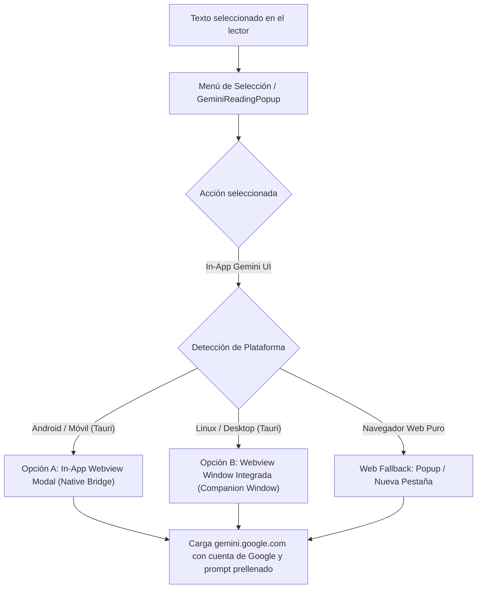

# Plan de Implementación: Gemini Web UI In-App (Opciones A y B)

Este plan detalla la arquitectura y pasos necesarios para renderizar la **interfaz real de la app de Google Gemini (`https://gemini.google.com/app`) directamente dentro de Readest/Minerva**, tanto en entornos móviles/Android (Opción A) como en escritorio Linux/Desktop (Opción B).

---

## 1. Descripción del Objetivo

El usuario desea que, al solicitar explicaciones o interacción extendida con Gemini, se pueda visualizar la **UI oficial de la app web de Gemini directamente dentro del entorno de Readest**, evitando que el usuario sea expulsado a un navegador externo o a la multitarea del sistema operativo.

### Solución Arquitectónica
Aprovechar la infraestructura nativa de **Tauri v2** y su plugin `tauri-plugin-native-bridge` ya presente en el proyecto:
- **Opción A (Android / Móvil):** Invocación del controlador nativo de Webview (`WebBrowserController` vía `native-bridge`), que despliega una hoja modal / In-App Browser con sesión persistente de Google.
- **Opción B (Linux / Desktop):** Creación de una ventana secundaria de Webview integrada (`WebviewWindowBuilder`) con título "Gemini Companion", tamaño optimizado, posición no obstructiva junto al lector y persistencia de cookies.
- **Entorno Web / PWA:** Fallback con diálogo modal o apertura en pestaña auxiliar cuando no hay runtime nativo de Tauri.



---

## 2. User Review Required

> [!IMPORTANT]
> **Persistencia de Sesión de Google:** Al usar los Webviews nativos de la plataforma (WebKitGTK en Linux y Android System WebView en Android), el inicio de sesión con tu cuenta de Google en Gemini se almacena en el almacén de cookies nativo de la app. Solo tendrás que iniciar sesión una vez.

> [!NOTE]
> Se mantendrá disponible la opción de alternar entre el **Popover flotante ligero** (con API Key) y el **Visor Webview Completo de Gemini** desde los ajustes de IA (`AISettings`), para que el usuario decida según su preferencia en cada momento.

---

## 3. Cambios Propuestos

### Componente 1: Servicio de Despacho In-App (`geminiIntent.ts` y `geminiWebview.ts`)

#### [MODIFY] `readest/apps/readest-app/src/app/reader/utils/geminiIntent.ts`
- Añadir el modo `'in-app-webview'` a las opciones de handoff.
- Exportar la función `openGeminiInAppBrowser(selectedText, action, options)` que interactúa con el servicio `openWebBrowser` de Readest cuando se ejecuta en Tauri.

```typescript
export async function openGeminiInAppBrowser(
  selectedText: string,
  action: GeminiHandoffAction = 'explain',
  options: GeminiHandoffOptions = {},
): Promise<boolean> {
  const query = buildGeminiQuery(selectedText, action, options.instruction);
  const url = buildGeminiWebUrl(query);

  if (isTauriAppPlatform()) {
    const { openWebBrowser } = await import('@/services/webBrowser/webBrowser');
    const { getWebBrowserOptions } = await import('@/services/webBrowser/webBrowserOptions');
    const browserOpts = getWebBrowserOptions((k) => k, false);
    await openWebBrowser(url, browserOpts);
    return true;
  }

  // Fallback para web tradicional
  openExternalUrl(url);
  return true;
}
```

---

### Componente 2: Integración en el Lector (`GeminiReadingPopup.tsx` y `Annotator.tsx`)

#### [MODIFY] `readest/apps/readest-app/src/app/reader/components/annotator/GeminiReadingPopup.tsx`
- En el pie del popover, el botón *"Abrir en Gemini"* ejecutará la visualización integrada In-App (Opción A o B según el dispositivo).
- Si la configuración tiene activado `geminiHandoffMode === 'in-app-browser'`, la acción directa de la barra de herramientas de selección abrirá inmediatamente la UI completa de Gemini sin necesidad de pasar por el streaming de texto plano.

---

### Componente 3: Configuración de Usuario (`AISettings.tsx` y `types.ts`)

#### [MODIFY] `readest/apps/readest-app/src/services/ai/types.ts`
- Extender `AISettings` con:
  - `geminiHandoffMode?: 'in-app-browser' | 'external-app';`

#### [MODIFY] `readest/apps/readest-app/src/components/settings/AIPanel.tsx`
- Añadir control segmentado / selector en la sección de Gemini:
  - **Experiencia de apertura:**
    - 📱 *UI integrada dentro de Readest* (In-App Browser / Companion Window)
    - ↗️ *App externa del sistema*

---

## 4. Plan de Verificación

### Pruebas Automatizadas
1. **Tests unitarios del despachador:**
   ```bash
   cd readest/apps/readest-app && pnpm test --run src/__tests__/utils/geminiIntent.test.ts
   ```
   Verificar que la función despache a `openWebBrowser` cuando `isTauriAppPlatform()` es verdadero, y a `openExternalUrl` cuando es falso.

2. **Chequeo de Tipos y Linter:**
   ```bash
   cd readest/apps/readest-app && npx tsc --noEmit
   npx biome check src/app/reader/utils/geminiIntent.ts src/app/reader/components/annotator/GeminiReadingPopup.tsx
   ```

### Verificación Manual
1. **En Linux Desktop (Opción B):**
   - Seleccionar un párrafo en cualquier libro.
   - Pulsar *"Abrir en Gemini"* (o el botón directo de Gemini si está configurado en modo In-App).
   - Verificar que emerge la ventana nativa de Webview con `gemini.google.com/app` y el prompt cargado en la caja de texto.
2. **En Android / Móvil (Opción A):**
   - Al tocar el botón en el APK, verificar que el controlador nativo de `native-bridge` levanta el Webview a pantalla completa con controles de navegación integrados y botón de cierre (*Close*).
